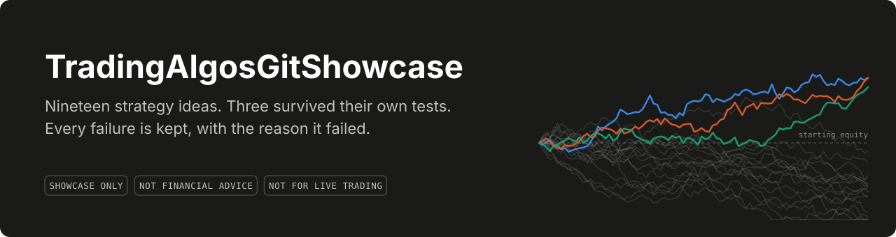
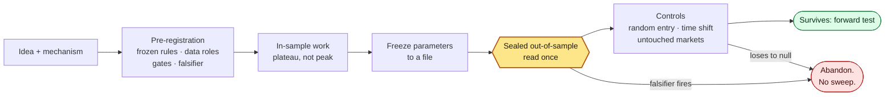
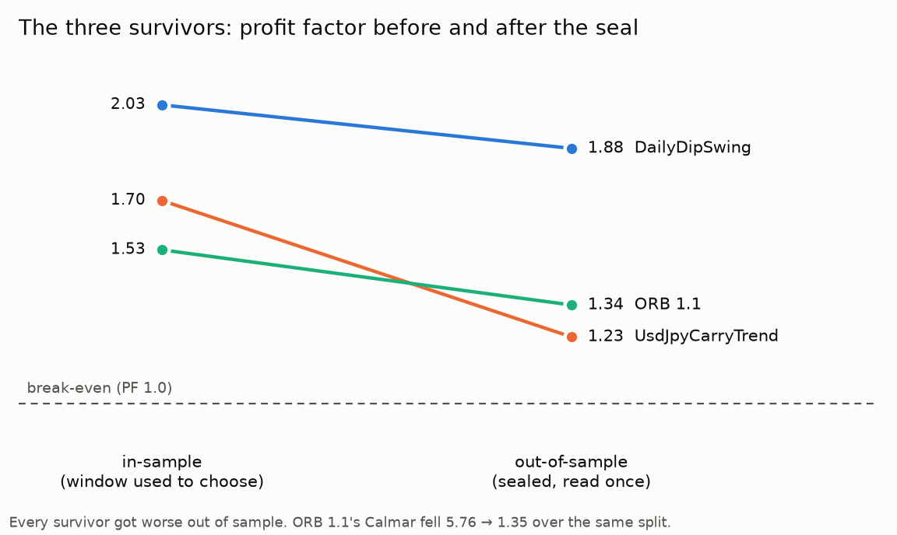
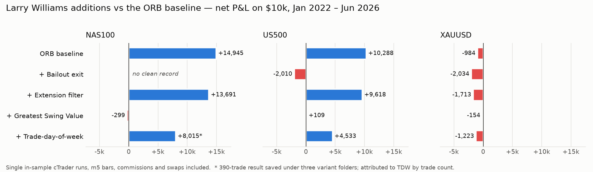

<div align="center">
  
</div>

> [!IMPORTANT]
> **This is a showcase, not a trading system.** It's a curated snapshot of a private research
> repository, published so people evaluating my work can see how I do it. **Nothing here is
> financial advice. Don't run any of this code against a live or funded account.** The strategies
> that survived testing are described without their code or parameters, on purpose. Full terms in
> [DISCLAIMER.md](DISCLAIMER.md).

---

Most strategy repositories show the one equity curve that went up. This one is mostly about the
other sixteen.

Between April and October 2026 I wrote nineteen trading strategies across cTrader (C#),
MetaTrader 5 (MQL5) and Python, ranging from a few hundred lines of opening-range breakout to a
queue-aware order-book simulator replaying CME market-by-order data through NautilusTrader. Three
survived their own pre-registered tests. Two of those are small. The best one kept about a quarter of its
in-sample risk-adjusted return the moment it met data it hadn't been tuned on.

The strategies aren't the interesting part. The process is: each idea gets written down, with the
number that would kill it, *before* the data that could kill it is read. When that number fires,
the idea is abandoned without a parameter sweep to rescue it. Most of this repository is that
process applied again and again, including the times it caught my own bugs.

## The ledger

**Survived** — write-up only; code and parameters withheld

| Idea | Platform · market | Test | Result |
|---|---|---|---|
| [ORB 1.0 → 1.1](research/survivors/orb-1.1.md) opening-range breakout | cTrader · US100 m5 | 160-pass IS grid → sealed OOS, 5 gates | PF 1.53 → **1.34**, +31% OOS; **Calmar 5.76 → 1.35 fails its gate** |
| [UsdJpyCarryTrend](research/survivors/usdjpy-carry-trend.md) | cTrader · USDJPY H1 | staged IS → sealed OOS, 4 gates | PF **1.23**, +13% OOS, all gates pass; ~100% of profit from 2024 |
| [DailyDipSwing](research/survivors/daily-dip-swing.md) daily dip-buyer | MT5 + Python · 10 indices × 35 y | IS/OOS → 10-market replication vs random-entry null | median PF **1.38**, beats null on 8/10; **Calmar 0.36 at any leverage** |

**Rejected** — code and results published

| Idea | Platform · market | Kill condition | Result |
|---|---|---|---|
| [Four Larry Williams additions](research/orb-larry-williams-ablation/README.md) to the ORB baseline | cTrader · NAS100/US500/XAUUSD | beat the baseline | none did; gold lost for every variant *(results only, see why)* |
| [ORB First-Move](research/orb-first-move/README.md), a mechanised discretionary framework | cTrader · XAUUSD/US100 m1 | — | **PF 0.66** after fixing the bugs behind a −78% run |
| [TPO value-area fade](research/tpo-value-fade/README.md) | cTrader · US500 M5 | PF < 1.05 | "profitable" run was one 596-lot position; fixed: **PF 0.88** |
| [Band-fade MR](research/band-fade/README.md) | cTrader · AUDNZD H1 | PF < 1.05 | **PF 0.56** |
| [Connors RSI(2)](research/mr-v1-connors-rsi2/README.md) | Python · 8 equity indices | ≥ 100 trades, PF > 1 | 94 and 93 trades, PF 1.56 / 1.17: **not supported** |
| [JJ Simon's Fair Value Theory](research/fvt-v1/README.md) | Python · ES 1m, 2,885 trades | net PF < 1.10 | **PF 0.66**, negative before costs |
| [V-Reversal footprint setup](research/v-reversal/README.md) | Python + Nautilus · ES MBO | ≥ 100 structures | 24 in 23 sessions: **unmeasurable** |
| [V2 order-book exhaustion](research/v2-order-book/README.md) | Python + Nautilus L3 · ES MBO | gross > +0.40 ticks/trade | **−0.07 ticks/trade**, PF 0.45; parked before OOS |
| [Seven early cBots](cbots/README.md): ICT, SMC, two order-flow + jump-diffusion, Donchian trend, overnight drift, BTC EMA cross | cTrader | — | failed or abandoned without a write-up; no reports kept |

**Pending** — one pre-registered idea (a VWAP-band fade on ES futures) that hasn't been run yet. It
isn't published.

## How an idea gets tested



The full method is in [`docs/methodology.md`](docs/methodology.md), and the blank pre-registration
I fill in before any test is in [`docs/hypothesis-template.md`](docs/hypothesis-template.md). The
short version:

- **The kill condition is a number, written first.** "PF below 1.05 → abandon", dated before the
  out-of-sample data is read. The document doesn't change afterwards; a changed rule is a new
  trial.
- **Test data is unreachable during tuning by construction.** Separate directories, never opened
  during tuning, read exactly once.
- **Parameters come from the plateau centre, not the best pass.** ORB 1.1's 160-pass grid was
  ranked by Calmar marginals. The platform's default ranking would have picked its worst corner.
- **The result has to beat a null, not just zero.** For a long-only dip-buyer the null is random
  entries on the same trend-filtered days, not buy-and-hold.
- **Missing a bar is a fail.** Connors RSI(2) missed its 100-trade minimum by six trades with a
  pooled PF of 1.56. It's recorded as a fail.

## What the sealed window did to the survivors

<picture>
  <source media="(prefers-color-scheme: dark)" srcset="docs/img/is-vs-oos-dark.png">
  
</picture>

All three survivors got worse out of sample, which is the expected direction when any choice was
made on the in-sample data. The size of the drop is the useful number. ORB 1.1's Calmar fell
4.3×, from 5.76 to 1.35: still a real edge, but a different strategy from the one the in-sample run
described. The same result also corrected a live evaluation. Eighteen live trades at PF 0.56 looked
significantly bad against the in-sample expectation (p ≈ 0.03) and unremarkable against the
out-of-sample one (p ≈ 0.10). Choosing the benchmark was the result.

## Things the process caught

**A −78% run that was mostly an execution bug.** cTrader rounds stop distances to whole pips on
the server, so any stop under 0.5 pips became zero and **the position opened with no stop at all**.
Fixed-fractional sizing on a $0.06 stop sized 10,842 oz of gold, about 200× leverage, and the trail
logic then computed a "tightened" stop 39R from entry. The fix: ceilinged stop on the order, exact
stop set by price after the fill, verify, flatten immediately if unprotected, and cap notional
whatever the sizing says. → [post-mortem](research/orb-first-move/README.md) ·
[code](cbots/OrbFirstMoveBot.cs#L896)

**A profitable backtest that was one position.** The TPO fade's first run made +3,567. The event
export showed the median position was 1 lot and one was 596. That trade made +4,974; the other
1,677 lost 783 between them. → [write-up](research/tpo-value-fade/README.md)

**A framework reporting 1 trade where there were 28.** Under NETTING order management,
NautilusTrader reuses one position ID per instrument, so its cache reported 1 closed position for
a session with 28 `PositionClosed` events. Round trips are now accumulated from the event stream.
→ [V2](research/v2-order-book/README.md)

**A small sample that flipped sign.** The V-Reversal setup's best configuration made +$1,562 on 5
exploratory trades (PF 3.28). Over 23 sessions it took 16 trades at PF 0.83. More data didn't
sharpen the estimate, it reversed it. → [V-Reversal](research/v-reversal/README.md)

**The same screenshot filed under three experiments.** In the Larry Williams study, three NAS100
results are one identical image. The write-up works out which run it belongs to and marks the
other cell as missing, rather than quoting the same number three times.
→ [ablation](research/orb-larry-williams-ablation/README.md#a-data-integrity-problem-and-how-its-handled)

**An 86% win rate that lost money.** Williams' bailout exit won 654 of 759 trades on US500 and
finished at PF 0.77: every winner cut at the first profitable close, every loser run to the full
stop.

## Larry Williams, tested

This is the study from the older of the two source repositories, and the one that made the rest of
the process necessary.

<picture>
  <source media="(prefers-color-scheme: dark)" srcset="docs/img/lw-ablation-dark.png">
  
</picture>

One baseline, four ideas from *Long-Term Secrets to Short-Term Trading*, each changing exactly one
thing. None beat the baseline. But every cell is a single in-sample run with nothing held out: a
fair way to reject four ideas, and no way at all to validate one. Pre-registration started with the
next step, ORB 1.1.

## Run it

**cBots**: compile all ten against the real cAlgo API (needs the .NET SDK):

```bash
dotnet build cbots
```

**Python**: Python 3.14, exact pins:

```bash
python3.14 -m venv .venv && .venv/bin/pip install -r python/requirements.txt
```

```bash
cd python && python MeanReversion1.py --generate-sample-data --no-plot
```

That last command backtests synthetic, upward-drifting series end to end. It's a smoke test of the
machinery, **not a result**. Everything else needs market data, which isn't included.

### Checks

| What | How |
|---|---|
| All ten cBots compile against `cTrader.Automate` (net6.0) | `dotnet build cbots`: 0 errors, 5 obsolete-API warnings in the early order-flow bots |
| Eight data-free selftests | `python <module> --selftest`, listed in [`python/README.md`](python/README.md) |
| Every module byte-compiles | `python -m compileall python tools` |
| MR V1 runs end to end | on generated data |
| Figures regenerate | `python tools/make_charts.py && python tools/make_banner.py` |

[CI](.github/workflows/ci.yml) runs all of it on every push. Six more selftests exist but open the
real data files, so they only run against the private repository.

## What's not here, and why

- **The survivors' code and parameters.** Process and results are enough to show the work. The
  rules that still work aren't needed for that.
- **The Larry Williams variants' code**, because each one is the survivor baseline plus one idea.
- **Market data.** Databento market-by-order data is licensed and can't be redistributed; broker
  CSV exports belong to the broker.
- **Third-party documents**: a trading-course PDF, a working paper, a book. They're cited where the
  research uses them.
- **Raw platform exports** (cTrader event logs and HTML reports, MT5 tester workbooks). The numbers
  that matter are quoted in the write-ups.
- **The pending hypothesis**, until it has been run.
- **The private repository's history.** This repository was created fresh.

## Limitations

- **Almost everything is a backtest.** Costs are modelled, not measured from my own fills; CFD
  results are on one broker's instruments; queue-position fills are a model of priority, not a
  guarantee.
- **The survivors' out-of-sample windows are short and kind.** DailyDipSwing's single-market OOS
  window was bull-only. UsdJpyCarryTrend made essentially all its OOS profit in one year. ORB 1.1's
  OOS run didn't charge commissions; the estimate with them makes its failed gate worse.
- **Seven early bots have no surviving reports.** They're labelled as failed or abandoned, and
  there's nothing here to check that against.
- **The Larry Williams study is in-sample only**, and one of its fifteen cells is missing.
- **Ten markets aren't ten independent tests.** SPX, NDX, DJI and RUT overlap heavily.

## Built with

C# (cTrader Automate, cAlgo.API) · MQL5 · Python (pandas, NumPy, NautilusTrader, Databento) ·
GitHub Actions. Much of the code and most of the research notes were written with an AI coding
assistant (Claude Code) as a pair programmer, which is why some notes refer to me in the third
person.

## Repository layout

```
research/                 one folder per line of research; verdicts in the ledger above
  survivors/              write-ups only: ORB 1.1, UsdJpyCarryTrend, DailyDipSwing
  orb-larry-williams-ablation/   the study from the older repository
  orb-first-move/  tpo-value-fade/  band-fade/        falsified cBots, with post-mortems
  mr-v1-connors-rsi2/  fvt-v1/  v-reversal/  v2-order-book/   Python studies, with pre-registrations
cbots/                    ten falsified or abandoned cTrader bots + a compile-check project
python/                   MR V1, FVT, V-Reversal and V2 engines, null models, selftests
mt5/                      ExportBarsCsv.mq5, a utility for exporting bar history
docs/                     methodology, hypothesis template, risk-management notes, figures
tools/                    scripts that draw every figure in this README
```

---

Bartek · [DISCLAIMER.md](DISCLAIMER.md)

<div align="center">
<sub>Research only. Not financial advice. Most of these ideas lost money; that's the point.</sub>
</div>
